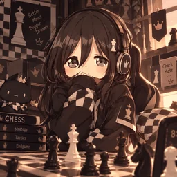

<div align="center">




#### 𝓜𝓲𝓴𝓪𝓼𝓪 𝓒𝓱𝓮𝓼𝓼


[](https://t.me/Ig_MikasaBot)
[](https://t.me/Ig_MikasaBot/Chess)


</div>

---

## ♛ About

Mikasa Chess is a real-time multiplayer chess game that runs as a Telegram Mini App. Create a lobby, share the invite link, and play a friend live, with spectators and chat. One Express and Socket.IO server serves the built React app, the API, and the multiplayer socket, so everything runs from a single service.

## ✨ Features

- **Live multiplayer.** Moves sync instantly over Socket.IO.
- **Lobbies and invites.** Create a lobby, share a join code, or open an invite link straight from Telegram.
- **Spectators and chat.** Watch matches live and chat in a slide-out drawer.
- **Draw offers, resign, and results.** In-match controls with a result screen at the end.
- **Player statistics and profiles.** Track your record and edit your profile. Your Telegram photo is used when available.
- **Board themes and settings.** Pick a look for the board and tune how it plays.
- **Sounds and animations.** Move sounds, a starting animation, and a grandmaster showcase.
- **Built-in chess bot.** Play against the computer when no opponent is around.

## 🧰 Tech stack

| Layer | Technology |
| --- | --- |
| Frontend | React, Vite, Tailwind CSS |
| Backend | Node.js 22, Express, TypeScript (run with `tsx`) |
| Realtime | Socket.IO |
| Platform | Telegram Mini App, Render |

## 🚀 Run locally

Requires **Node.js 22** (see `.node-version`).

```bash
npm install
cp .env.example .env     # set TELEGRAM_BOT_TOKEN from @BotFather
npm run dev
```

## ☁️ Deploy

Full Render steps are in [README-RENDER.md](README-RENDER.md). In short: create a **Blueprint** or **Web Service** from this repo, then set the environment variables below.

| Variable | Value |
| --- | --- |
| `TELEGRAM_BOT_TOKEN` | Token from @BotFather (keep it secret) |
| `APP_URL` | `https://<your-service>.onrender.com` |
| `NODE_ENV` | `production` |
| `BOT_USERNAME` | Optional. Bot handle without the `@`. Default `Ig_MikasaBot`. |
| `VITE_BOT_USERNAME` | Optional, build time. Bot handle used in invite links. Default `Ig_MikasaBot`. |
| `VITE_MINIAPP_SHORT_NAME` | Optional, build time. Mini App short name. Default `Chess`. |

Build command: `npm install && npm run build`  
Start command: `npm start`  
Health check: `/api/health`

## 🤖 Telegram

Open **[@Ig_MikasaBot](https://t.me/Ig_MikasaBot)** and press **Start** once, then launch the **Chess** Mini App. Players who have opened the bot get their profile photo in the app.

---

<div align="center">

*Good moves, good company.*

</div>
